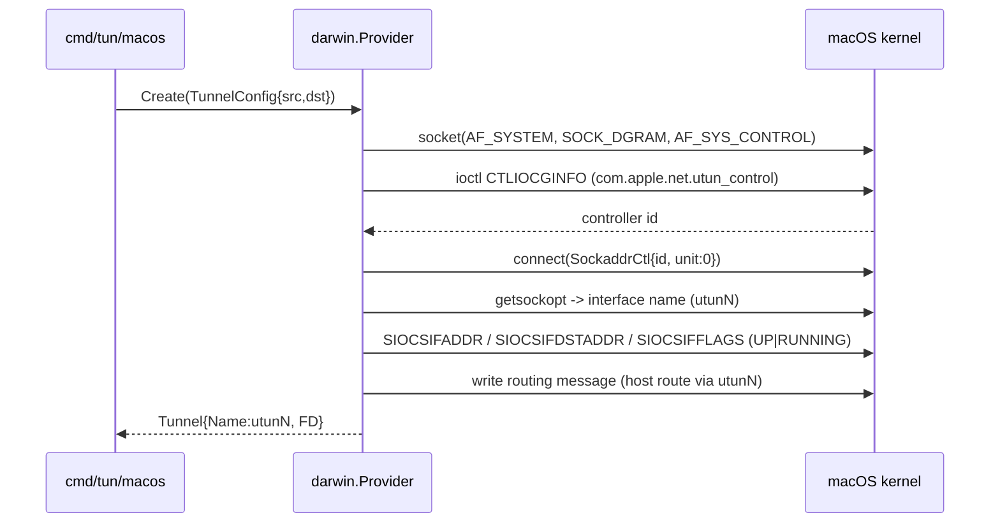
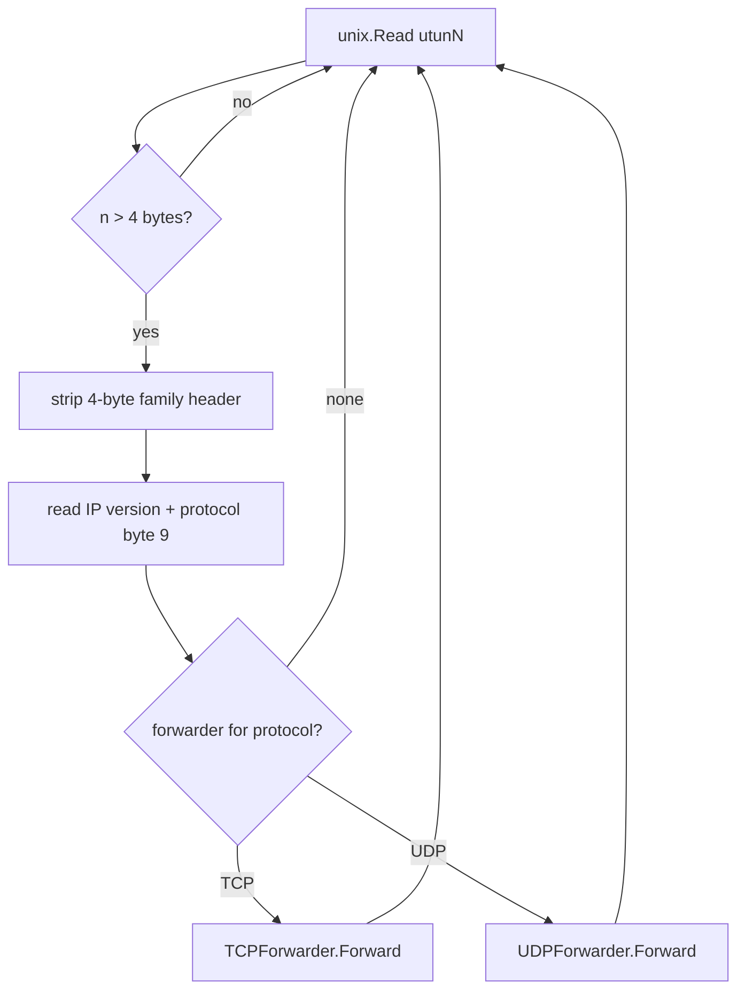
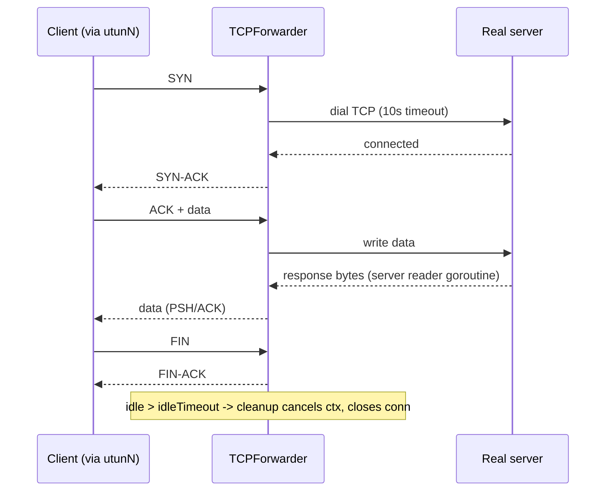
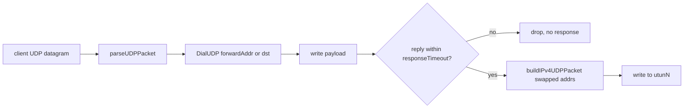

# gotun Architecture

Status: Complete
Owner: ECecillo
Last Updated: 2026-10-16
Related Issue: `#1`

## 1. Purpose

This document describes how `gotun` is structured today, derived directly from
the source tree. It explains the macOS UTUN bring-up sequence, the packet read
loop, and the TCP/UDP forwarding paths, and separates what exists today from
what is planned on the roadmap. It is the deliverable tracked by issue `#1`.

## 2. Scope

### In Scope

- The client data plane: UTUN creation and packet forwarding on macOS.
- The helper binaries used for local testing (`cmd/server`, `cmd/devtool`).
- The package boundaries between `pkg/tunnel` (platform-agnostic) and
  `pkg/tunnel/darwin` (macOS implementation).

### Out of Scope

- Any non-macOS platform. All data-plane code carries a `//go:build darwin`
  constraint and uses macOS-only kernel control interfaces.
- A control plane. There is no session/auth service today; those live on the
  roadmap (see §10).

## 3. High-Level Architecture

- `gotun` creates a userspace tunnel on macOS using the native UTUN kernel
  control interface (`com.apple.net.utun_control`), with no kernel extension.
- The client binary (`cmd/tun/macos`) brings up a `utunN` interface, assigns a
  point-to-point IPv4 address pair, and installs a host route toward the tunnel
  peer.
- A single read loop pulls IP packets off the interface and dispatches them by
  IP protocol number to a registered forwarder.
- UDP is forwarded statelessly (datagram in, optional datagram back).
- TCP is handled by a transparent user-space proxy that terminates the client
  flow, dials the real destination, and bridges bytes while synthesizing the
  TCP control packets the client expects.
- Everything that mutates kernel network state (control sockets, interface
  configuration, routing) requires root.
- The included server (`cmd/server`) is a minimal UDP echo responder used only
  for local end-to-end testing; it is not yet a real VPN server.

## 4. Components and Boundaries

### 4.1 Client Data Plane

- Binary: `cmd/tun/macos` (`//go:build darwin`).
  - Parses configuration from environment variables (`caarlos0/env`).
  - Creates the tunnel via `darwin.NewProvider().Create(...)`.
  - Builds a UDP forwarder and a TCP forwarder, registers them by protocol
    number in a `map[uint8]darwin.ProtocolForwarder`, and runs a
    `darwin.TunnelReader`.
  - Installs a `SIGINT`/`SIGTERM` handler for graceful shutdown
    (`reader.Close()`), which closes every forwarder.
- Package: `pkg/tunnel/darwin` (`//go:build darwin`). The macOS implementation.
  - `darwin.go` — `Provider.Create` orchestrates the full bring-up sequence
    (§5.1) and returns a `tunnel.Tunnel{Name, FD}`.
  - `socket.go` — opens the three sockets used: kernel control
    (`AF_SYSTEM`/`SOCK_DGRAM`/`AF_SYS_CONTROL`), network manager
    (`AF_INET`/`SOCK_DGRAM`), and routing (`AF_ROUTE`/`SOCK_RAW`).
  - `ioctl.go` — constructs `CTLIOCGINFO` (`_IOWR('N', 3, ctl_info)` =
    `0xC0644E03`), retrieves the UTUN controller id, connects to it, and reads
    back the assigned interface name.
  - `network_interface_config.go` — the `ifconfig` equivalent: set source and
    destination addresses (`SIOCSIFADDR`, `SIOCSIFDSTADDR`) and raise the `UP`
    and `RUNNING` flags (`SIOCGIFFLAGS`/`SIOCSIFFLAGS`).
  - `ip_router_config.go` — hand-builds a routing-socket message
    (`RtMsghdr` + `RawSockaddrInet4` + `SockaddrDatalink`) equivalent to
    `route add -host <dst> -interface utunN`.
  - `reader.go` — the read loop and protocol dispatch (§5.2).
  - `tcp_packet.go` / `udp_packet.go` — pure packet parse/build plus the IP and
    TCP checksums (RFC 1071 one's-complement).
  - `tcp_forwarder.go` / `udp_forwarder.go` — the forwarding logic (§5.3, §5.4).
  - `protocol.go` — IP protocol numbers and `ProtocolName`.
- Explicit non-responsibilities: no encryption, no authentication, no IPv6, no
  Linux/Windows support.

### 4.2 Server Data Plane

- Binary: `cmd/server`. A minimal UDP echo server: it listens on a configured
  UDP port and replies `ACK: <message>` to each datagram. It exists to validate
  the forwarding path locally.
- Explicit non-responsibilities today: no authentication, no access control, no
  session tracking, no metrics. These are roadmap items (§10).

### 4.3 Tooling / Shared

- `pkg/tunnel` — platform-agnostic contracts:
  - `TunnelProvider` interface (`Create`, `Close`).
  - `TunnelConfig{SourceIP, DestinationIP}`.
  - `Tunnel{Name, FD}`.
- `cmd/devtool` — a UDP/TCP request sender (`DEVTOOL_PROTOCOL=udp|tcp`) that
  sends a message and prints the response; used to drive traffic through the
  tunnel during local testing.

## 5. Core Flows

### 5.1 UTUN Creation / Bring-up

`Provider.Create` (in `darwin.go`) performs these steps in order:

1. Open a kernel control socket — `OpenKernelControlSocket()`
   (`unix.Socket(AF_SYSTEM, SOCK_DGRAM, AF_SYS_CONTROL)`).
2. Retrieve the UTUN controller id — `RetrieveUTUNControllerID(fd)` issues the
   `CTLIOCGINFO` ioctl with name `com.apple.net.utun_control`.
3. Connect to the UTUN controller — `ConnectToUTUNController(fd, info)` via
   `unix.Connect` with `SockaddrCtl{ID, Unit: 0}` (unit `0` = auto-assign the
   next free `utunN`).
4. Read the assigned interface name — `GetUTUNInterfaceName(fd)` via
   `GetsockoptString(AF_SYS_CONTROL, AF_INET)` (e.g. `utun3`).
5. Configure addresses and bring the interface up —
   `NetworkInterfaceConfigurator.Configure(name, srcIP, dstIP)` sets the source
   and destination addresses and raises `UP`+`RUNNING`. Equivalent to
   `ifconfig utunN 10.0.0.2 10.0.0.1 up`.
6. Install the host route — `IPRouterConfigurator.Configure(name, dstIP)` writes
   a routing-socket message so packets to the peer egress through `utunN`.
   Equivalent to `route add -host 10.0.0.1 -interface utunN`.

`Create` returns `tunnel.Tunnel{Name: utunN, FD: controlSocketFD}`. The
configurator sockets are closed with `defer`; the control socket FD stays open
as the tunnel handle and is closed by `Provider.Close`.

### 5.2 Packet Read Loop and Dispatch

`TunnelReader.Run` (in `reader.go`) loops until a read error:

- `readPacket` calls `unix.Read(fd, buffer)` into a 2000-byte buffer. The first
  `utunHeaderLen` (4) bytes are the macOS protocol-family header; packets of 4
  bytes or fewer are skipped. The returned slice is the raw IP packet
  (`buffer[4:n]`).
- `handlePacket` reads the IP version (`byte[0] >> 4`) and protocol
  (`byte[9]`), logs source/destination, and dispatches to
  `forwarders[protocol].Forward(ipPacket)` when a forwarder is registered for
  that protocol. Unregistered protocols are observed and dropped.
- `Close` closes every registered forwarder.

### 5.3 TCP Forwarding (transparent proxy)

`TCPForwarder` (in `tcp_forwarder.go`) terminates each client TCP flow in user
space and proxies it to the real destination.

- Connection identity: `connectionKey{srcIP[4], dstIP[4], srcPort, dstPort}`.
  The `connections` map is guarded by `TCPForwarder.mu` (an `RWMutex`); each
  `tcpConnection` has its own `mu` (`Mutex`), the client/server sequence
  numbers, a `state` (`CLOSED`/`SYN_RECEIVED`/`ESTABLISHED`/`FIN_WAIT`),
  `lastActive`, and a per-connection `context` with its `cancel`.
- `Forward` classifies each packet:
  - `RST` → `handleRST` removes the connection.
  - `SYN` without `ACK` → `handleSYN`: `net.DialTimeout("tcp", dst, 10s)` to the
    real server; on failure it replies `RST`. On success it creates a
    `tcpConnection` (its context derived from the forwarder context), replaces
    any existing entry for the key, sends `SYN-ACK`, and starts a
    `startServerReader` goroutine.
  - otherwise it looks up the connection; if none exists it replies `RST`;
    otherwise it refreshes `lastActive` and routes `FIN`/`ACK`+data accordingly.
- Server → client pump: `startServerReader` reads the server connection with a
  1-second read deadline so it can poll `ctx.Done()` between reads, forwards
  data to the client (`sendDataToClient`), and on exit sends a `FIN` to the
  client and removes the connection.
- Timeouts and cancellation:
  - `startCleanupLoop` ticks every 10s and calls `cleanupIdleConnections`,
    which evicts any connection idle longer than `idleTimeout` (cancel context,
    close server connection, delete from the map).
  - `Close` cancels the forwarder context and every connection context, closes
    all server connections, and clears the map.
- Locking discipline: acquire `TCPForwarder.mu` for map operations, then
  `tcpConnection.mu` for per-connection state; the `*Locked` send helpers assume
  `tcpConnection.mu` is already held.
- Packet synthesis: outbound packets (`SYN-ACK`, `ACK`, `FIN-ACK`, `RST`, data)
  are built with `buildIPv4TCPPacket`, which fills the IPv4 and TCP headers and
  computes both checksums before writing to the UTUN FD.

### 5.4 UDP Forwarding (stateless)

`UDPForwarder` (in `udp_forwarder.go`) handles each datagram synchronously
inside the read loop; there is no connection table.

- `Forward` parses the datagram (`parseUDPPacket`) and calls
  `forwardAndGetResponse`.
- `forwardAndGetResponse` dials UDP to `forwardAddr` when configured, otherwise
  to the packet's own destination; writes the payload; and waits up to
  `responseTimeout` for a reply. A timeout is treated as "no response" (returns
  `nil`, no error).
- When a reply arrives, `writeResponseToTun` builds a response IPv4/UDP packet
  with source/destination addresses and ports swapped (`buildIPv4UDPPacket`) and
  writes it back to the UTUN FD so the client sees a normal UDP response.

## 6. Failure Domains and Recovery

| Failure domain | Detection | Behavior today |
|---|---|---|
| UTUN creation failure | `Provider.Create` returns an error | Client logs and exits (`log.Fatalf`); nothing is left half-configured because configurator sockets are closed on return |
| TCP dial to server fails | `net.DialTimeout` error in `handleSYN` | Forwarder replies `RST` to the client; no connection stored |
| TCP connection idle | `cleanupIdleConnections` (10s tick) sees `idle > idleTimeout` | Context cancelled, server connection closed, entry removed |
| UDP response timeout | read deadline in `forwardAndGetResponse` | Datagram silently dropped (no reply synthesized) |
| Read loop error | `unix.Read` error in `readPacket` | Loop terminates; the client must be restarted |

There is no automatic reconnect/self-heal layer yet; that is roadmap work.

## 7. Security Model (today)

- Requires root to open kernel control sockets, configure the interface, and
  write routes.
- The data plane is **not encrypted or authenticated** today — `gotun` forwards
  cleartext IPv4 TCP/UDP. It is a tunnel data-plane experiment, not yet a secure
  VPN. Transport security, identity, and policy are roadmap items (§10).
- Operational guidance: review the code before running with `sudo`; do not
  expose the test server on untrusted networks.

## 8. Observability (today)

- Logging is `log`/`fmt` to stdout/stderr with emoji-tagged lines for the read
  loop and forwarders (packet seen, forwarded bytes, connection lifecycle,
  cleanup). There are no structured logs, metrics, or health endpoints yet;
  these are roadmap items (§10).

## 9. Non-Goals (current)

- IPv6 (the parse/build helpers are IPv4-only).
- Linux/Windows (macOS-only kernel control interfaces).
- Data-plane encryption/authentication.
- Multi-client server fan-out.

## 10. Roadmap: Today vs Planned

Implemented today:

- macOS UTUN bring-up (control socket, ioctl, address + route configuration).
- Read loop with protocol dispatch.
- Stateless UDP forwarding with response write-back.
- Experimental transparent TCP proxy with idle eviction and graceful shutdown.
- A UDP echo server and a send tool for local end-to-end testing.

Planned (tracked in the project roadmap, GitHub issues `#1`–`#20`). Issue `#1`
is this architecture document. The remaining issues cover the hardening themes
captured during early design:

- Authentication + key management (per-client certs/keys, short-lived
  credentials, rotation).
- Access-control policies (per-client subnet/port ACLs).
- Session management (active sessions, device identity, revoke/kick).
- Observability (structured logs, per-client metrics, health endpoints).
- Reliability hardening (reconnect, keepalives, graceful restart).
- DNS + routing controls (pushed DNS, split/full tunnel, conflict detection).
- Rate limiting + abuse protection (per-client bandwidth/connection limits).
  This theme is not yet filed as an issue and is slated to be opened.
- Audit trail (auth events, config/policy changes, admin actions).

## 11. Open Questions

- TCP proxy initial server sequence number is currently fixed; sequence-space
  handling and window management need review before non-test use.
- Whether UDP should maintain per-flow sockets rather than dialing per datagram.
